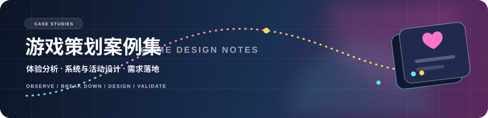

  

  <strong>Play. Break down. Design.</strong> 
  休闲 / 社交游戏体验分析 × 系统设计 × 活动玩法

## 关于这本案例集

这里收录我在休闲与社交游戏方向上的部分分析与设计案例，重点关注：

- 玩家如何在核心循环中获得目标、反馈与成长；
- 系统如何服务于留存、社交互动与商业化；
- 活动玩法如何从概念拆解为清晰、可执行的规则与页面流程。

> 以下内容为公开摘要，原始需求文档、后台配置、具体参数、内部素材和实现细节均未公开。

## Case Index｜案例索引

<table>
  <tr>
    <td width="50%" valign="top">
      <h3>🔎 休闲游戏体验报告</h3>
      
对多款休闲社交产品进行横向体验，拆解核心循环、卡牌、社交、活动与商业化设计。

      
<code>竞品分析</code> <code>核心循环</code> <code>商业化</code>

      <a href="./cases/01-casual-game-ux-report.md">查看案例摘要 →</a>
    </td>
    <td width="50%" valign="top">
      <h3>🁴 Domino Dreams 体验分析</h3>
      
围绕图案匹配、关卡策略与资源循环，分析“解谜玩法 + 建造养成 + 社交”的组合方式。

      
<code>玩法拆解</code> <code>经济循环</code> <code>体验节奏</code>

      <a href="./cases/02-domino-dreams-analysis.md">查看案例摘要 →</a>
    </td>
  </tr>
  <tr>
    <td width="50%" valign="top">
      <h3>🔁 卡片交换集市</h3>
      
面向卡牌收集场景设计好友 / 公会交换活动，串联请求、赠予、领取与活动奖励。

      
<code>活动系统</code> <code>社交循环</code> <code>需求设计</code>

      <a href="./cases/03-card-exchange-market.md">查看案例摘要 →</a>
    </td>
    <td width="50%" valign="top">
      <h3>🃏 翻牌热潮</h3>
      
围绕翻牌配对、奖励关与代币消耗设计限时活动，通过阶段性反馈强化局内目标感。

      
<code>休闲玩法</code> <code>关卡设计</code> <code>活动落地</code>

      <a href="./cases/04-flip-card-frenzy.md">查看案例摘要 →</a>
    </td>
  </tr>
</table>

## How I Work｜我的工作方式

| 观察 | 拆解 | 设计 |
| :--- | :--- | :--- |
| 带着记录体验目标，关注玩家在每个阶段的目标与反馈。 | 把体验变化对应回核心循环、资源和系统规则。 | 将结论整理为玩法目标、流程、界面与异常状态需求。 |

---

  返回 
  <a href="https://github.com/fantasticdzw">fantasticdzw · GitHub Profile</a>

